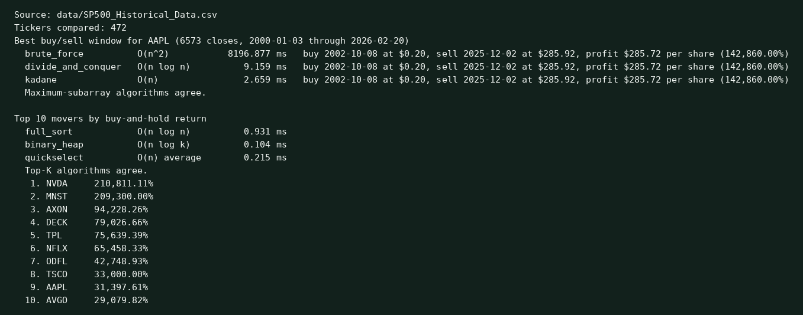

# Historical Stock Market Algorithm Analyzer

CPS 3440 group project at Kean University. The program finds the best single buy and later sell in a price series, and the top movers in a universe, with several algorithms whose costs are far apart. Every published timing was run on the downloaded Kaggle S&P 500 file.

Team: Aashish Joshi, Aron Dardouri, Bhartendra Kumar Mandal, and Brian Lucero.

Site: https://aashish000000.github.io/CPS3440-Stock-Algorithm-Analyzer/

## Layout

`analyzer/` is the source folder. The course layout calls this directory `src/`. The package name is what `python3 -m analyzer` imports, so the directory keeps that name.

| Path | What it is |
| --- | --- |
| `analyzer/` | Source: the library and the command-line tool. Standard library only. |
| `results/results.json` | Medians, operation counts, the machine, and the one projected brute-force cell. |
| `figures/` | Benchmark plots. The same files are copied into `docs/assets/` for GitHub Pages. |
| `docs/` | GitHub Pages: the site, the paper, the PDF, and the figure copies. |
| `docs/algorithms.md` | Pseudocode, correctness, and best, average, and worst bounds. |
| `presentation/` | The slide deck and the timed speaker script. |
| `tests/` | Unit tests, including the CLRS maximum-subarray example. |
| `CONTRIBUTIONS.md` | Responsibilities and two resume bullets per person. |
| `data/README.md` | How to download the Kaggle CSV. |
| `data/SP500_Historical_Data.csv` | The Kaggle download. Gitignored. About 143 MB. |
| `LICENSE` | MIT license. |

## Algorithms

Daily adjusted-close changes are integers in micro-dollars. The sum of a contiguous block is the profit per share of one buy and one later sell. Ties keep the earliest window.

| Algorithm | Best | Average | Worst | Extra space |
| --- | --- | --- | --- | --- |
| Brute force | Θ(n²) | Θ(n²) | Θ(n²) | Θ(n) |
| Divide and conquer | Θ(n log n) | Θ(n log n) | Θ(n log n) | Θ(log n) |
| Kadane | Θ(n) | Θ(n) | Θ(n) | Θ(1) |

Top-K uses the order (higher score, then earlier ticker). The scaling study uses k = 10. The full sort is merge sort. The heap is a hand-written min-heap with `push`, `replace_root`, and `sift_down`. Quickselect is the third Top-K method and is in the benchmark.

| Algorithm | Best | Average | Worst | Extra space |
| --- | --- | --- | --- | --- |
| Merge sort | Θ(n log n) | Θ(n log n) | Θ(n log n) | Θ(n) |
| Binary heap of size K | Θ(n + k log k) | Θ(n log k) bound | Θ(n log k) | Θ(k) |
| Quickselect | Θ(n) | Θ(n) | Θ(n²) | Θ(log n) |

## Technologies

- Python 3.12, standard library only for the analyzer and the tests
- matplotlib for the benchmark figures
- qrcode and Pillow for the site QR code and the CLI screenshot
- python-pptx for the slide deck
- The public dataset is the Kaggle file `jacksaleeby/s-and-p500-historical-data`

## Run the analyzer

Place the Kaggle export at `data/SP500_Historical_Data.csv`. The steps are in `data/README.md`. Columns are `Ticker`, `Date`, `Open`, `High`, `Low`, `Close`, `Adj Close`, and `Volume`. This download has 2,703,531 rows, 472 tickers, and dates from 2000-01-03 through 2026-02-20.

```bash
python3 -m pip install -r requirements.txt
python3 -m analyzer --ticker AAPL --k 10
python3 -m analyzer --ticker AAPL --k 10 --html docs/results.html
python3 -m unittest discover -s tests
```

On that file the three window algorithms agree: buy AAPL on 2002-10-08 at $0.20 and sell on 2025-12-02 at $285.92, profit $285.72 per share. Merge sort, the heap, and quickselect agree on the top 10 buy-and-hold returns, led by NVDA at 210,811.11%.

`--since` and `--until` take `YYYY-MM-DD`. The offline sample is `tests/fixtures/sample.csv`.

One run of `python3 -m analyzer --ticker AAPL --k 10` on the Kaggle file:



## Benchmark

```bash
python3 -m analyzer.benchmark --data data/SP500_Historical_Data.csv --out results/results.json --figures figures
python3 docs/render.py
```

The timer uses prefixes of 1,000, 10,000, 100,000, and 1,000,000 records. Sizes through 10,000 records use five trials and the median. Brute force at 100,000 records is one measured trial: 33.5 minutes, 402 ns per pair. The 1,000,000-record brute-force time is the n² projection from that trial, 55.8 hours, and it is labeled projected. A second column counts pair iterations, element reads, or comparisons. `results/results.json` records Python 3.12.3 and the CPU, an Intel Xeon.

On the market prefix the time per pair rose from 103 ns at 1,000 records to 353 ns at 10,000 and then leveled near 402 ns at 100,000. A positive window does extra work, and a longer prefix of Python integers also leaves cache. The same function on zero-mean random integers stayed near 324 ns and 404 ns per pair, so a zero mean does not remove the cost. The pair count stays n(n+1)/2 either way.

Kadane's measured median at 1,000,000 records is 497 ms. Divide and conquer's is 2.04 s. On market order at 1,000,000 daily moves, the size-10 heap median is 115 ms, quickselect is 340 ms, and merge sort is 5.41 s.

`docs/render.py` rebuilds `docs/index.html` and `docs/paper.html` from `results/results.json`, and writes `docs/assets/site-qr.png`.

## Paper, slides, and site

GitHub Pages serves the `docs/` directory. The technical paper is `docs/paper.html` and `docs/paper.pdf`. It includes the section **Algorithmic Efficiency versus Computational Hardness**, a theory-versus-observed discussion, and CLO reflections A through D.

Regenerate the PDF from the repository root:

```bash
google-chrome --headless --disable-gpu --no-sandbox \
  --user-data-dir=/tmp/chrome-paper \
  --no-pdf-header-footer \
  --print-to-pdf=docs/paper.pdf \
  file://$PWD/docs/paper.html
```

The deck is `presentation/CPS3440-Stock-Algorithm-Analyzer.pptx`. Rebuild it with `python3 presentation/build_slides.py`. The timed script is `presentation/SPEAKER_SCRIPT.md`. One slide carries the QR code for the site.

Resume lines grounded in these measurements are in `CONTRIBUTIONS.md`.
